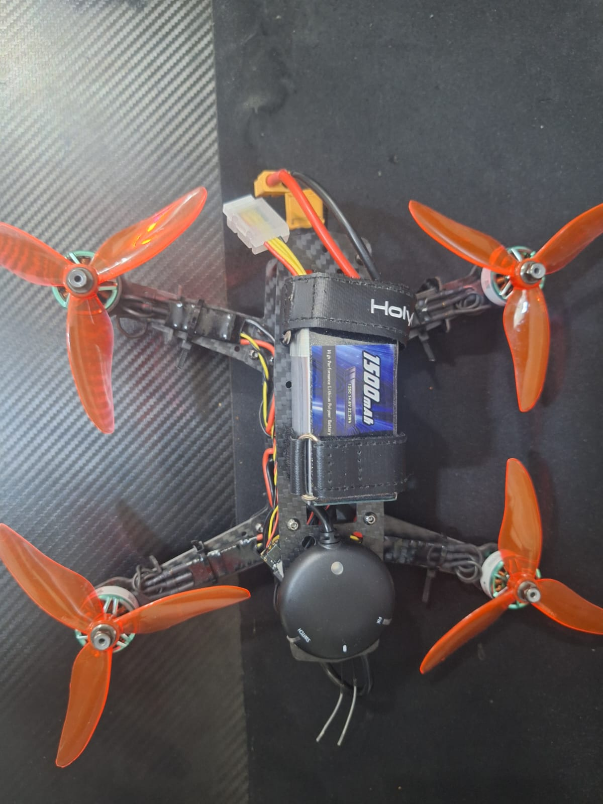

# FPV_Drone

A small 250-class quadcopter (5-inch props, 4S LiPo) flown by a **Holybro Pixhawk 6C Mini
running PX4**. It is the second drone in AlfaisalX, next to [RAPTOR](../RAPTOR).

**Status (22 October 2026):** built and photographed, and the flight controller has been
read over USB. **What the drone is for has not been decided yet**; see
[Open questions](#open-questions).



## Hardware

Most of this was identified from the [photos](./assets/photos). The flight controller rows
were read from the board itself over USB on 22 October 2026, using PX4's `ver all` and
MAVLink `AUTOPILOT_VERSION`.

| Part | What it is | Source |
|---|---|---|
| Kit | Matches Holybro's [QAV250 kit](https://holybro.com/products/qav250-kit): 250 carbon frame, Pixhawk 6C Mini, GPS, 433 MHz radio | Photos; still to confirm |
| Flight controller | Holybro **Pixhawk 6C Mini**: board target `PX4_FMU_V6C`, hardware type `V6C002002`, STM32H7. The board reports only the 6C family; the photos show the Mini case | Read over USB |
| Firmware | **PX4 1.16.1**, build type `c0` (release candidate), NuttX 11.0.0, built 21 Jan 2026 | Read over USB |
| Unique ID | PX4 GUID `0006000000003332333533335115004b0035`, MAVLink UID `3333511533323335` | Read over USB |
| Motors | T-Motor Velox V2207 V2 (KV not readable in the photos) | Photos |
| Props | 5-inch three-blade, orange | Photos |
| Battery | 1500 mAh 4S LiPo (14.8 V, 22.2 Wh), XT60 | Photos |
| GPS | Round puck with a safety switch, top deck | Photos |
| Telemetry | 433 MHz 100 mW telemetry radio, under the bottom plate | Photos |
| RC receiver | Two antenna leads beside the GPS; model not visible | Photos |
| ESC | Not visible in the photos | — |
| FPV camera / video transmitter | **None fitted** in the photos | — |

The USB serial string the board reports is just `0`, so the PX4 GUID is the number that
tells this board apart from others, including RAPTOR's Pixhawk 6C. Holybro's printed
serial number is on the case label and is a different number.

## Compared with RAPTOR

| | RAPTOR | FPV_Drone |
|---|---|---|
| Airframe | X500 V2 | 250-class carbon |
| Props | 10-inch (254 mm) | 5-inch |
| Flight controller | Pixhawk 6C | Pixhawk 6C Mini, PX4 1.16.1 |
| Onboard computer | Jetson Orin NX | None |
| Camera | SIYI A8 mini gimbal | None fitted |

## Open questions

1. **What is it for?** Options so far: a small, cheap testbed for RAPTOR's PX4 and MAVLink
   work; a small search scout; or autonomy and control research.
2. **Firmware.** The installed PX4 build reports itself as a release candidate. Decide
   whether to flash the stable release before the first flight.
3. **Battery.** Holybro recommends a 4S 2200–3000 mAh pack for the QAV250; the fitted
   1500 mAh pack will give short flights.
4. **Parts still to confirm** against the kit paperwork: motor KV, ESC, RC receiver and
   GPS model.

## Reading the board again

Plug the Pixhawk into a laptop over USB-C, with the battery unplugged. Then do either of
these:

- In QGroundControl, open *Analyze Tools → MAVLink Console* and run `ver all`.
- Run [`src/tools/read_pixhawk_id.py`](./src/tools/read_pixhawk_id.py) (needs
  `pip install pymavlink pyserial`). It only reads; it never arms the board or changes a
  parameter.

## Repository structure

```
FPV_Drone/
├── README.md
├── assets/        photos of the build (see assets/README.md)
└── src/tools/     read_pixhawk_id.py: firmware, board and unique ID over USB
```
