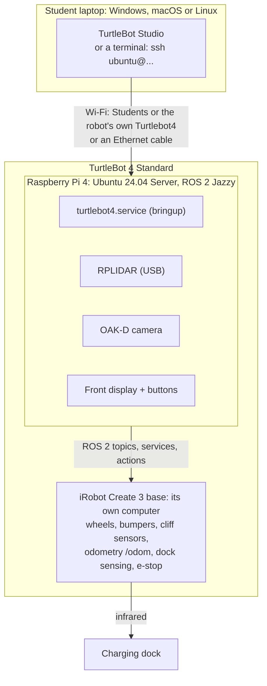
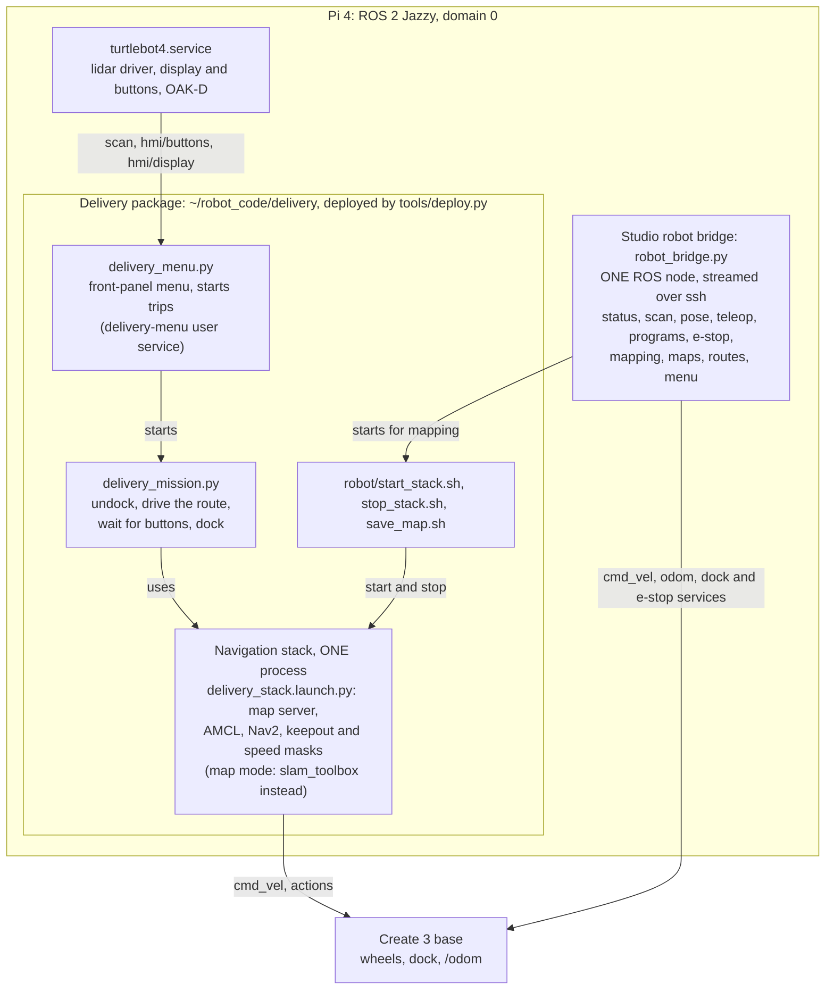
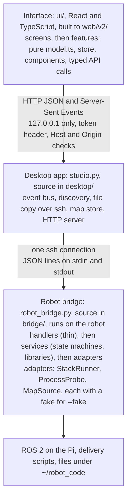
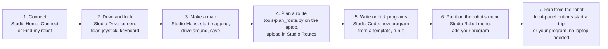

# Architecture of the TurtleBot 4 system

How the lab's TurtleBot 4 setup fits together, at three levels: the whole system, the software on the robot, and the TurtleBot Studio app. Every statement comes from the records named in the text. Anything not run on the real robot is marked **NOT VERIFIED**. Back to the [TurtleBot README](README.md).

## 1. Context: laptop, network, robot

| Part | Role | Source |
|---|---|---|
| Laptop | Runs Studio or an ssh terminal. Nothing needs to be installed on the robot for Studio | [tools/studio/README.md](tools/studio/README.md) |
| Network | Campus Wi-Fi `Students` (address on the robot's display, starts with `10.87.`), the robot's own hotspot `Turtlebot4` (`10.42.0.1`), or an Ethernet cable (IPv6 link-local address, or a fixed address you set) | [HOW-TO-CONNECT.md](HOW-TO-CONNECT.md) |
| Raspberry Pi 4 | Runs ROS 2 Jazzy and the TurtleBot 4 bringup as the systemd unit `turtlebot4.service`; reads the lidar; hosts your programs in `~/robot_code` | [MAINTENANCE.md](MAINTENANCE.md#current-configuration-as-of-2026-10-03-rechecked-where-marked-on-2026-10-04) |
| Create 3 base | Drives the wheels, publishes odometry and dock status, detects the dock. Reached from the Pi over the ROS 2 network | [docs/explanations/how-a-command-travels.html](docs/explanations/how-a-command-travels.html) |

Why it is built this way: the Pi and the base are two computers that talk over ROS 2. A new ROS participant on the Pi (every `ros2` command, every Studio connection) can stall the base's topics for several seconds. This is the open task TB-25 ([ROADMAP.md](ROADMAP.md#tb-25-find-why-the-create-3-base-stalls-when-it-starts-moving), [MAINTENANCE.md](MAINTENANCE.md#finding-odom-pauses-at-motion-start)). Much of the design below follows from that.

## 2. Software on the robot

**Bringup.** `turtlebot4.service` starts the stock TurtleBot 4 software. The delivery scripts source `/etc/turtlebot4/setup.bash`.

**Delivery package** ([delivery/README.md](delivery/README.md), ROADMAP [TB-29](ROADMAP.md#tb-29-campus-food-delivery-along-the-wall-supervised-demo)).

| Piece | What it does |
|---|---|
| `delivery_menu.py`, `menu_core.py`, `ros_buttons.py` | The front-panel menu. `menu_core.py` is pure logic with no ROS, so the offline tests cover it. The program runs as the `delivery-menu` systemd user service (`robot/install_menu.sh`, no sudo) |
| `delivery_mission.py`, `delivery_core.py` | One trip: undock, drive the waypoints with Nav2, wait for button 3 (vendor) at the food court and button 4 (student) at the lab, drive home, dock. Stops when `~/STOP` exists |
| `launch/delivery_stack.launch.py` | The whole navigation stack in one process (map server, AMCL, mask servers, Nav2 servers) under one lifecycle manager |
| `robot/start_stack.sh`, `stop_stack.sh`, `save_map.sh` | Start the stack in `map` or `nav` mode, stop it, save the slam_toolbox map. Detached, no sudo, stop uses SIGINT |
| `tools/plan_route.py`, `tools/deploy.py` | Run on the laptop: plan a route on a saved map, copy the folder to the robot as a numbered release |
| `config/` | Nav2, AMCL and slam_toolbox parameters (upstream file kept for comparison) |
| `sim/` | Simulator on the Pi with a fake base, so Nav2 can run with the robot on its dock |

**Status of the delivery.** Full deliveries have run on the real robot at home from the front-panel menu (2026-11-06). The campus route has not been driven. The physical front-panel buttons on the new menu were not confirmed as of the delivery README. See [ROADMAP.md](ROADMAP.md) for the current state.

**Studio's robot bridge.** One Python file streamed to the robot's `python3` over ssh when Studio connects. It is the only ROS participant Studio adds (TB-25), and it also starts the delivery scripts for mapping. Details in section 3.

## 3. TurtleBot Studio

Studio runs on the student's computer. Its layers, from [tools/studio/README.md](tools/studio/README.md#architecture) and [tools/studio/docs/DESIGN-MAPPING.md](tools/studio/docs/DESIGN-MAPPING.md) (section 2):

The full Studio design, with the flows for connecting, running a program, E-STOP, mapping and saving the menu, is
in [tools/studio/docs/ARCHITECTURE.md](tools/studio/docs/ARCHITECTURE.md).

With `--fake` the same desktop and interface talk to a simulated robot in a local process. Everything in the offline tests uses it. It says nothing about the real robot.

## 4. Workflow: from an empty room to a delivery

What a student or lab member does, in order, and which part of the system does the work at each step.

| Step | What does the work | Read |
|---|---|---|
| 1 Connect | Studio desktop app opens one ssh connection and streams the bridge | [FIRST-CONNECTION.md](tools/studio/docs/FIRST-CONNECTION.md) |
| 2 Drive | The bridge publishes speeds on `/cmd_vel`, capped at 0.30 m/s | [LIVE-AND-DRIVING.md](tools/studio/docs/LIVE-AND-DRIVING.md) |
| 3 Map | The bridge runs `start_stack.sh map` (slam_toolbox) and `save_map.sh` | [MAPS-AND-ROUTES.md](tools/studio/docs/MAPS-AND-ROUTES.md) |
| 4 Route | `plan_route.py` writes a route folder; Studio uploads it and sets the current link | [delivery/README.md](delivery/README.md) |
| 5 Programs | Programs live in `~/robot_code`; moving ones need confirmation | [EVERYDAY-USE.md](tools/studio/docs/EVERYDAY-USE.md) |
| 6 Menu | The robot's `menu_config.py` checks the file before it is saved | [ROBOT-MENU.md](tools/studio/docs/ROBOT-MENU.md) |
| 7 Run | `delivery_menu.py` starts the trip or program and shows the result | [delivery/README.md](delivery/README.md) |

## 5. Key constraints and why

| Constraint | Why | Where it is recorded |
|---|---|---|
| One ROS participant for Studio (TB-25) | Every new ROS participant can stall the base for several seconds, so the bridge keeps one node. `/map` and `/pose` are subscriptions on that node, created on request. The delivery stack is one process for the same reason | [DESIGN-MAPPING.md](tools/studio/docs/DESIGN-MAPPING.md), [delivery/README.md](delivery/README.md#2-safety-first) |
| Start the stack once, then run no other `ros2` commands and make no Studio reconnects during a run | The same stall risk. The mission waits for a steady `/odom` before it moves | [delivery/README.md](delivery/README.md#2-safety-first) |
| No sudo | Studio and the delivery scripts never use admin rights. The menu is a user service. The password is never stored, requested or logged by Studio | [Studio security model](tools/studio/README.md#security-model) |
| Read-only by default | Nothing in the mapping feature moves the wheels. Studio never undocks or docks by itself. Saving never overwrites without a second confirmation. Menu saves are atomic with a `.bak` copy | [Studio safety design](tools/studio/README.md#safety-design) |
| Driving is armed on purpose | Arming is refused when e-stop is on, the robot is docked, a program runs, or the battery is low. It disarms on any doubt (connection lost, leaving the Live screen, mapping start) | [Studio README, safety design of driving](tools/studio/README.md) |
| Speed caps | Driving caps 0.30 m/s and 1.20 rad/s; motion templates 0.15 m/s and 1.0 rad/s; delivery 0.20 m/s | [tools/studio/README.md](tools/studio/README.md), [delivery/README.md](delivery/README.md#2-safety-first) |
| Supervised only | A person stays next to the robot. Glass and cables are invisible to the lidar | [delivery/README.md](delivery/README.md#2-safety-first) |
| Studio talks only to the lab robot | Every ssh call pins the robot's host key; the server binds to 127.0.0.1 | [Studio security model](tools/studio/README.md#security-model) |

### Emergency stop paths

| Path | What it does |
|---|---|
| E-STOP in Studio (Esc or Space) | Sends zero velocity ten times, creates `~/STOP`, stops the motion programs, switches the drive motors off, cancels a dock or undock. If the bridge fails, a separate one-shot ssh command does it |
| `~/STOP` file on the robot | `touch ~/STOP` stops `delivery_mission.py` and the motion programs. Programs refuse to start while it exists. Remove it with `rm ~/STOP` |
| Controller button B | Toggles the Create 3 emergency stop. **NOT VERIFIED on this robot** (delivery README) |
| Front-panel button 2 | Stop while a trip runs. Physical presses **NOT confirmed** on the new menu |
| Create 3 `/e_stop` service | Works, but returns `success=False` with an empty message on this firmware, so judge by the wheels ([MAINTENANCE.md known issues](MAINTENANCE.md#known-issues)) |

## 6. Where to read more

| Question | Document |
|---|---|
| How does one command reach the wheels? | [how-a-command-travels.html](docs/explanations/how-a-command-travels.html) |
| What changed on the robot, and how do I undo it? | [MAINTENANCE.md](MAINTENANCE.md) |
| What is planned? | [ROADMAP.md](ROADMAP.md) |
| How do I work in this folder? | [CONTRIBUTING.md](CONTRIBUTING.md) |
| All documents by type | [docs/README.md](docs/README.md) |
