# TurtleBot Studio architecture

How Studio is built and how a request travels through it, from the button you click to the robot's wheels. The
structure follows [arc42](https://arc42.org/overview) (goals, context, building blocks, runtime, deployment,
cross-cutting rules, decisions, risks). The diagrams follow the [C4 model](https://c4model.com/): each one zooms
one level further in. GitHub draws them directly on this page.

For the robot as a whole (the Pi, the base, the delivery programs) read [TurtleBot/ARCHITECTURE.md](../../../ARCHITECTURE.md).
To find the file for a job, read [CODE-MAP.md](CODE-MAP.md).

Contents: [1 Goals](#1-goals) · [2 Constraints](#2-constraints) · [3 Context](#3-context) ·
[4 The three running parts](#4-the-three-running-parts) · [5 Inside each part](#5-inside-each-part) ·
[6 How things happen](#6-how-things-happen) · [7 States](#7-states) · [8 Where it runs](#8-where-it-runs) ·
[9 Rules that apply everywhere](#9-rules-that-apply-everywhere) · [10 Decisions](#10-decisions) ·
[11 Risks and known debt](#11-risks-and-known-debt) · [12 Words used here](#12-words-used-here)

## 1. Goals

Studio lets a student drive the lab's TurtleBot 4, run and write programs for it, make maps, and change its
front-panel menu, from their own laptop, with nothing installed on the robot.

When two goals pull in different directions, the higher one wins:

| Rank | Quality | What it means here |
|---|---|---|
| 1 | Safety | The robot never moves unless a person asked for it on purpose. E-STOP always works, even if the main connection is broken. |
| 2 | Security | Only the lab robot, only from this laptop. No password is ever stored, asked for or logged. |
| 3 | Robustness | Campus Wi-Fi drops and cables come out. Studio reconnects by itself and never resends a movement after a reconnect. |
| 4 | Ease of use | A first-year student can connect, drive and run a program without reading a manual. |
| 5 | Easy to change | A new student can find and change one feature without reading the rest. |

## 2. Constraints

| Constraint | Why | Decision record |
|---|---|---|
| One ROS participant for all of Studio | Each new ROS participant can stall the Create 3 base for up to about 12 s (TB-25) | [ADR-0001](adr/0001-one-ros-participant.md) |
| Nothing installed on the robot | Many laptops with different Studio versions share one robot | [ADR-0002](adr/0002-streamed-single-file-bridge.md) |
| No sudo, no password handling | The robot is shared lab equipment | [README, security model](../README.md#security-model) |
| Python standard library only on the desktop and robot side | Students install nothing; the packaged app is one folder | [ADR-0002](adr/0002-streamed-single-file-bridge.md) |
| Windows, macOS and Linux laptops | Students bring their own | |

## 3. Context

Who and what Studio deals with (C4 level 1).

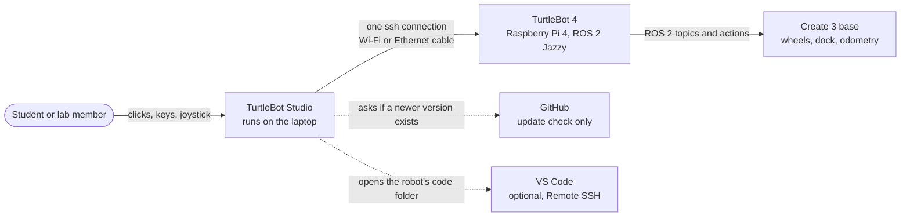

The laptop and the robot meet on campus Wi-Fi (`Students`), on the robot's own hotspot, or on an Ethernet cable.
[HOW-TO-CONNECT.md](../../../HOW-TO-CONNECT.md) covers the network.

## 4. The three running parts

Studio is three programs that run at the same time (C4 level 2). The browser shows the screens, the desktop app
does everything that needs the laptop, and the robot bridge does everything that needs the robot.

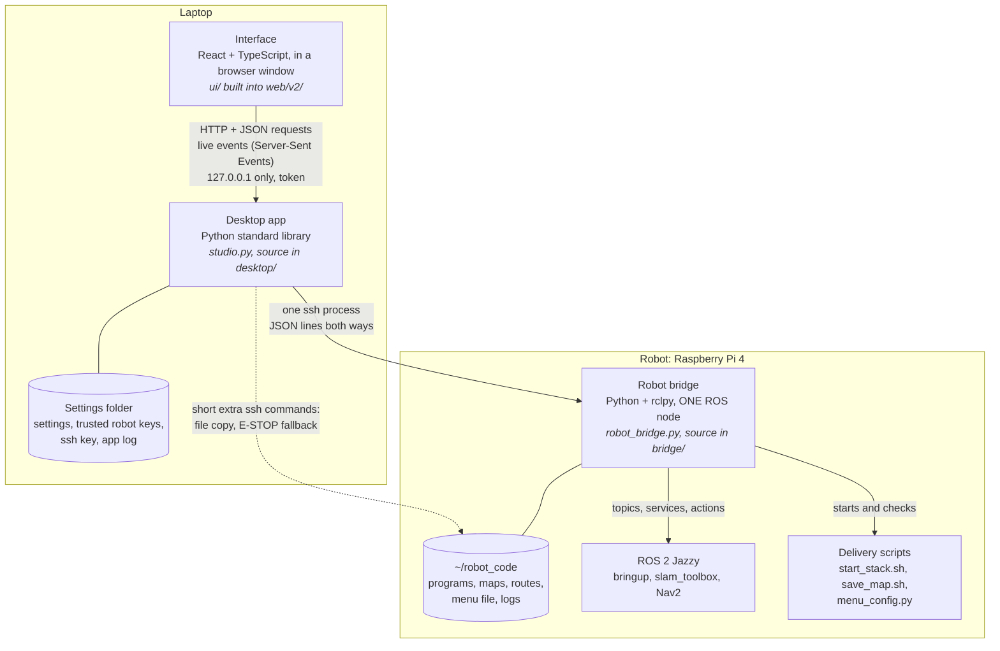

| Part | Runs where | Its job | Talks to |
|---|---|---|---|
| Interface | The laptop's browser (or Studio's own window) | Screens, buttons, drawing the map and lidar, keyboard driving, E-STOP key | Desktop app only, over `http://127.0.0.1:<port>` |
| Desktop app | The laptop | Finds the robot, holds the one ssh connection, keeps settings and trusted keys, copies files, stores map pictures, decides when a program counts as "moving", serves the interface | Interface (HTTP), robot bridge (ssh), GitHub (update check) |
| Robot bridge | The robot's `python3`, from memory | The only ROS node Studio adds. Reads sensors, publishes driving speeds, runs programs, mapping, maps, routes and the menu file | Desktop app (stdin and stdout), ROS 2, files under `~/robot_code` |

**How the bridge gets to the robot.** At connect time the desktop app starts
`ssh ubuntu@robot "... python3 -u -c '<10-line loader>'"`, then writes the length of `robot_bridge.py` and its
bytes on the ssh connection. The loader runs them. From then on each side writes one JSON object per line. Every
command carries an `id`, and the reply carries the same `id`. Events (battery, scan, program output, mapping)
arrive without being asked for.

## 5. Inside each part

C4 level 3. The file for each box is in [CODE-MAP.md](CODE-MAP.md).

### 5.1 Interface

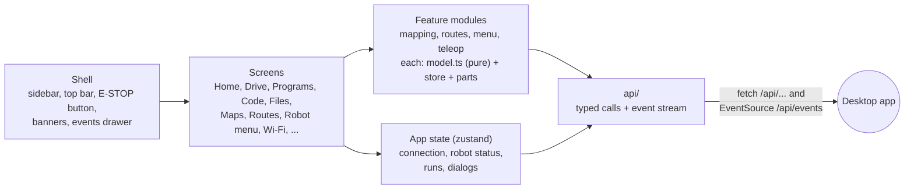

Rules: a screen never calls `fetch` itself; it goes through `api/`. Logic that can be tested without a browser
lives in pure `model.ts` files.

### 5.2 Desktop app

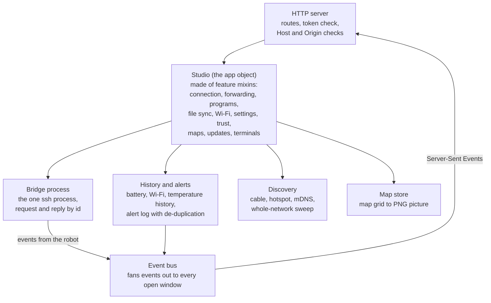

### 5.3 Robot bridge

The bridge is layered so the risky parts are small and tested (ADR-0003, [DESIGN-MAPPING.md](DESIGN-MAPPING.md)
section 2):

```mermaid
flowchart TB
    main["main loop<br/>reads one JSON command per line"]
    handlers["Handlers (Bridge, made of feature mixins)<br/>h_run, h_estop, h_mapping_start, h_menu_put, ...<br/>check the input, call a service, reply"]
    services["Services<br/>MappingService (state machine), MapLibrary,<br/>RouteLibrary, MenuService, runs"]
    adapters["Adapters<br/>StackRunner, ProcessProbe, MapSource<br/>each has a fake for --fake"]
    ros["ROS layer<br/>RosReal (rclpy) or FakeRos (simulated robot)"]
    writer["Writer<br/>one locked stdout, drops old<br/>scan frames under load"]
    pure["Pure helpers<br/>names, paths, YAML, PGM, poses,<br/>Wi-Fi text, journal: no I/O"]

    main --> handlers --> services --> adapters
    handlers --> ros
    handlers --> writer
    services --> pure
    handlers --> pure
```

Handlers stay thin: a handler checks the command, calls one service, and returns the reply. A service never
talks to ROS or to processes directly; it goes through an adapter, so a test can swap in a fake.

## 6. How things happen

### 6.1 Connecting

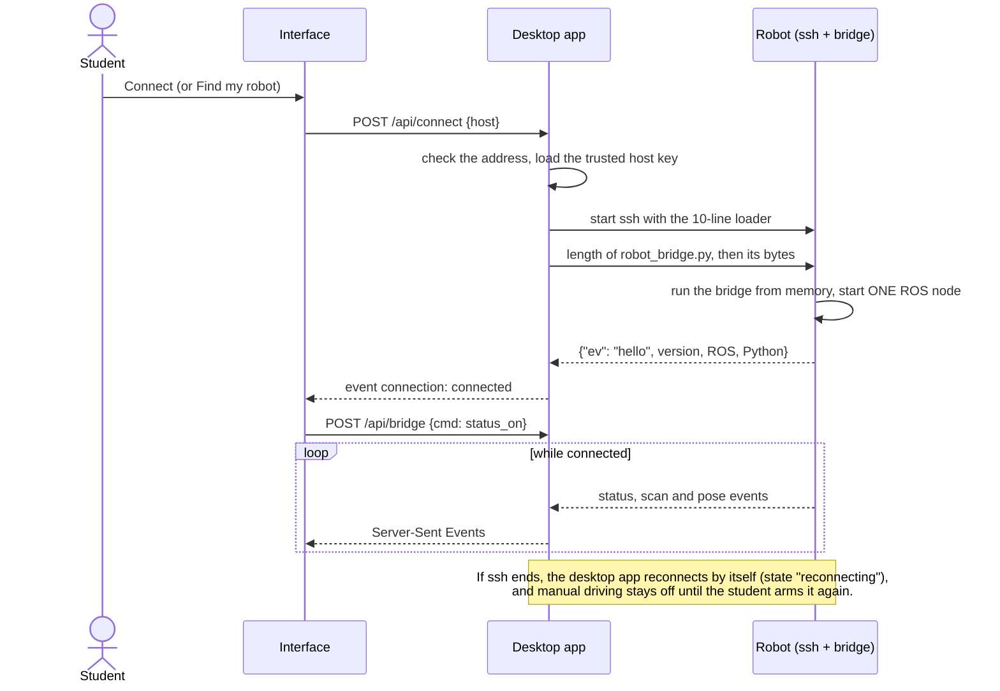

### 6.2 Running a program

The decision "does this program move the robot?" is made on the desktop, from the program catalog, and checked
again on the robot.

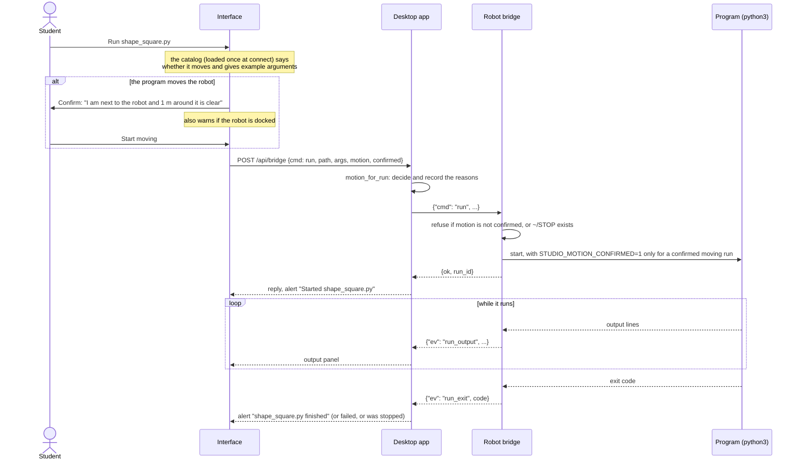

### 6.3 E-STOP

There are two independent paths, so E-STOP still works when the main connection is the thing that failed.

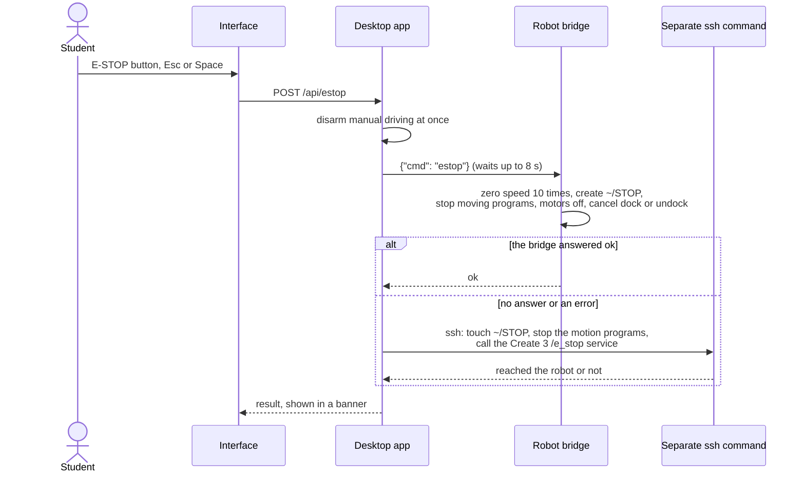

### 6.4 Making and saving a map

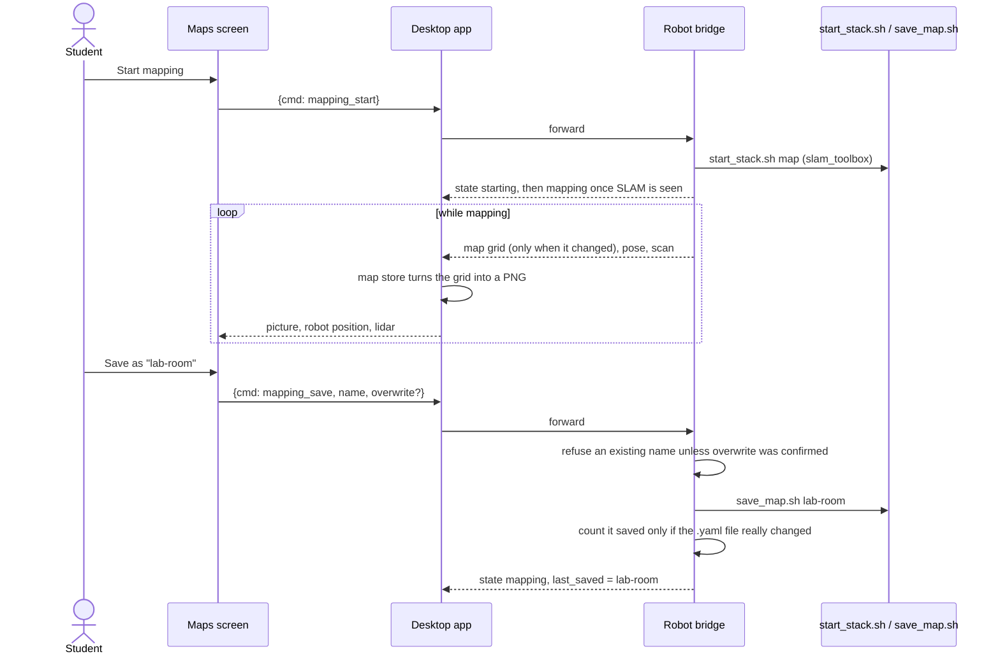

### 6.5 Saving the robot's front-panel menu

The robot's own checker decides what a valid menu is, so Studio and the robot can never disagree (ADR-0005).

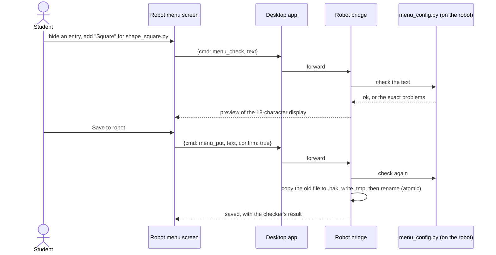

## 7. States

### 7.1 Connection (desktop app)

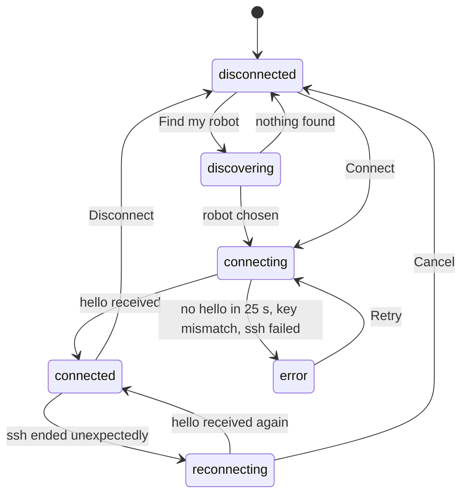

### 7.2 Mapping (robot bridge, `MappingService`)

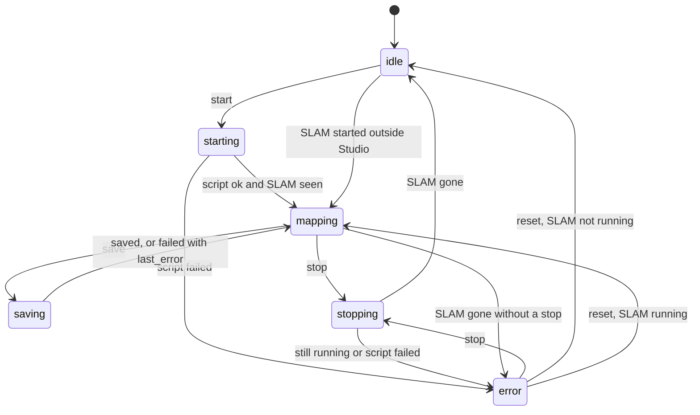

## 8. Where it runs

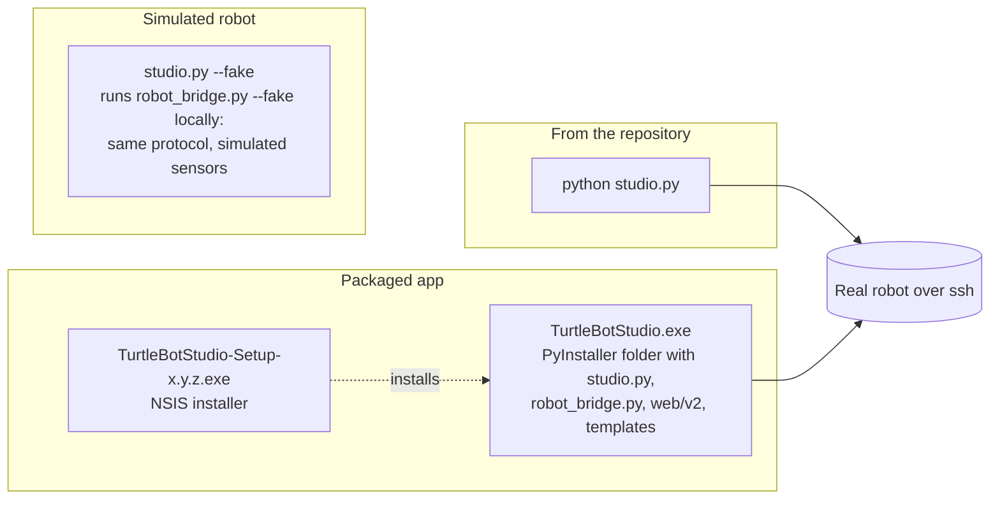

The simulated robot speaks exactly the same protocol as the real bridge ([ADR-0007](adr/0007-simulated-robot-behind-the-same-protocol.md)).
Every offline and browser test uses it. It proves the software, not the robot.

**Building.** `python bundle.py` joins the source modules into `studio.py` and `robot_bridge.py`
([ADR-0008](adr/0008-small-source-modules-joined-into-single-files.md)). `npm run build` in `ui/` writes
`web/v2/`. `python packaging/build.py` makes the Windows app. CI checks that the committed joined files and
`web/v2/` match their source.

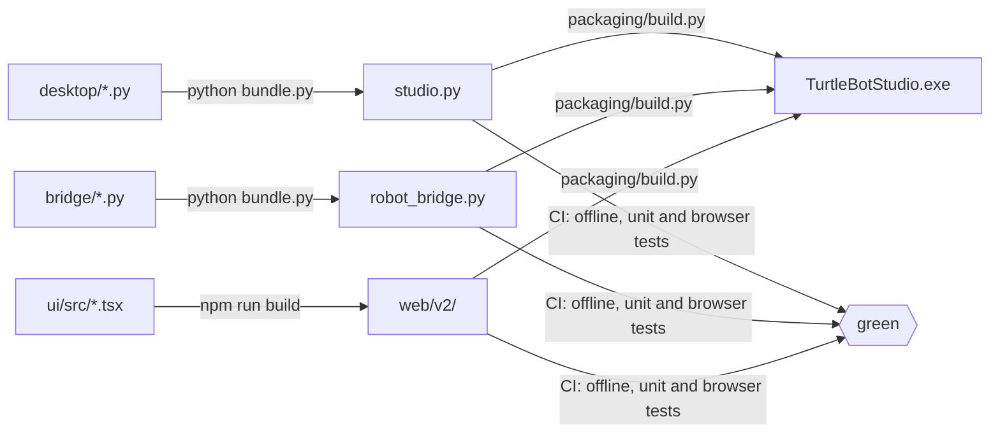

## 9. Rules that apply everywhere

**Safety.**
- Movement is opt-in twice: the interface asks for confirmation, and the bridge refuses a moving run without it.
- Manual driving must be armed, and is disarmed on any doubt: connection lost, leaving the Drive screen, mapping
  start, E-STOP. A new bridge process always starts disarmed, so nothing is resent after a reconnect.
- Speed limits live in three places on purpose: the settings, the desktop app (which overwrites what the page
  sends), and the bridge (which caps again).
- `~/STOP` stops everything that moves and blocks new moving runs until it is removed.

**Security.**
- The web server listens on `127.0.0.1` only, with a random token per launch and Host and Origin checks.
- Every ssh call pins the robot's host key. The app never sees a password; key setup happens in a terminal that
  ssh itself opens.
- Diagnostics remove passwords, keys and the token before showing anything.

**Files on the robot.** Writes are atomic (write a temporary file, then rename). A replaced file keeps a `.bak`
copy. Nothing is overwritten without a second confirmation (ADR-0006). Paths are checked to stay inside
`~/robot_code`.

**Errors.** Every reply is `{ok: true, ...}` or `{ok: false, error: "<a sentence a student can act on>"}`. The
interface shows the sentence; it never shows a stack trace.

**Testing.** See [TESTING.md](TESTING.md). In short:

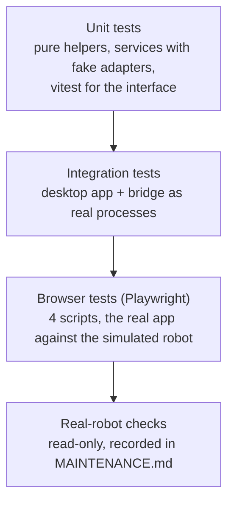

## 10. Decisions

| ADR | Decision |
|---|---|
| [0001](adr/0001-one-ros-participant.md) | One ROS participant for all of Studio |
| [0002](adr/0002-streamed-single-file-bridge.md) | The robot side is one file, streamed over ssh |
| [0003](adr/0003-mapping-runs-the-delivery-scripts.md) | Mapping runs the delivery package's scripts |
| [0004](adr/0004-maps-as-png-on-the-desktop.md) | Maps become PNG pictures on the desktop |
| [0005](adr/0005-robot-owned-menu-validation.md) | The robot's own checker validates the menu |
| [0006](adr/0006-atomic-writes-no-silent-overwrite.md) | Atomic writes, no silent overwrite |
| [0007](adr/0007-simulated-robot-behind-the-same-protocol.md) | The simulated robot speaks the same protocol |
| [0008](adr/0008-small-source-modules-joined-into-single-files.md) | Small source modules, joined into the two single files |

## 11. Risks and known debt

| Item | Effect | What would fix it |
|---|---|---|
| Base stalls when a ROS participant joins (TB-25) | A reconnect during a run can freeze the wheels for seconds | Root cause on the Create 3 side; until then, one node and no reconnect during runs |
| `make_handler` is one long routing function | Adding an endpoint means editing a long function | A route table, when the next endpoint is added |
| Studio 2.0 and the classic `web/app.js` interface both ship | Two interfaces to keep working | Remove the classic one after a term with no use |

## 12. Words used here

| Word | Meaning |
|---|---|
| Bridge | The Studio program that runs on the robot for as long as Studio is connected |
| Catalog | `programs.json`: what each known program does, whether it moves the robot, example arguments |
| Event | A message the robot sends without being asked (battery, scan, program output) |
| Mixin | A class that holds one feature's methods; the main class is made of several of them |
| Node | A program that takes part in ROS 2 |
| SLAM | Building a map while finding your place in it (slam_toolbox) |
| SSE | Server-Sent Events: the desktop app pushes live events to the browser over one open request |
| Topic | A named ROS 2 channel, such as `/scan` (lidar) or `/cmd_vel` (driving speed) |
