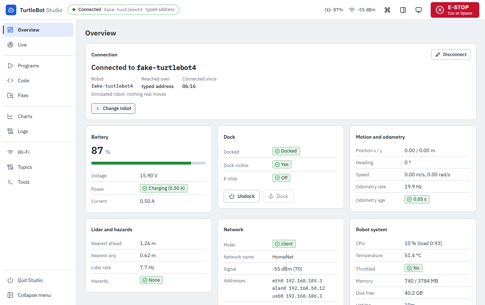
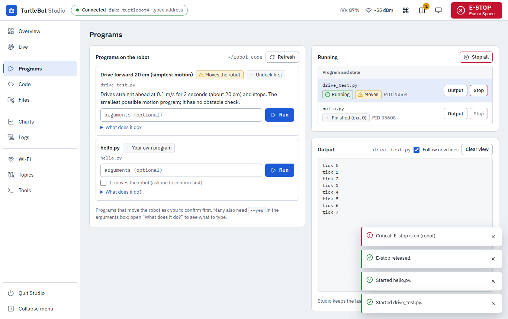
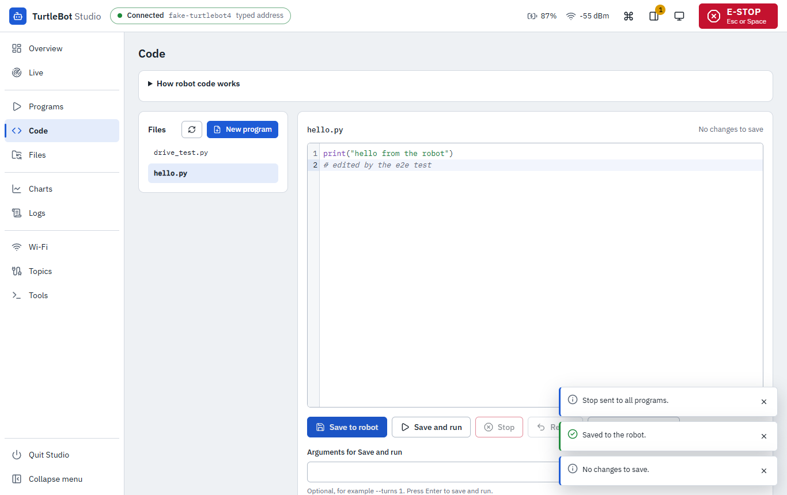
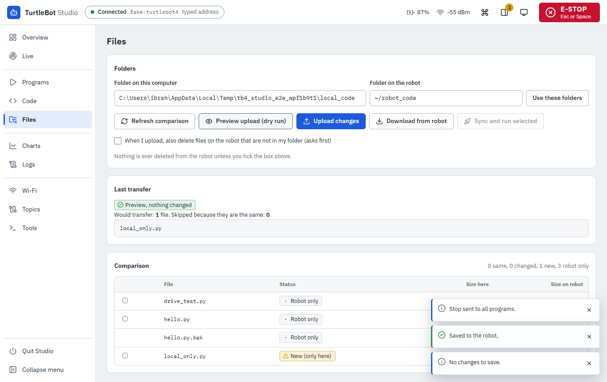
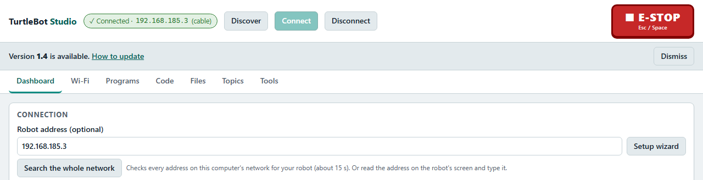
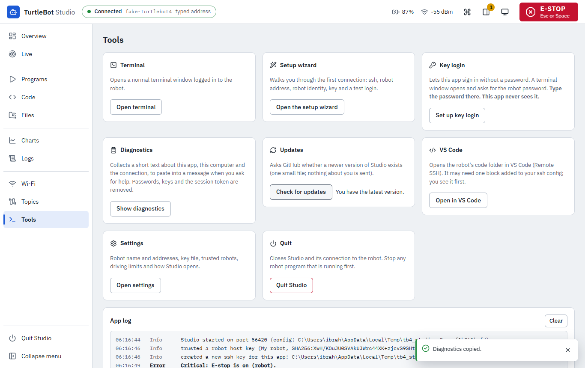

# Everyday use

How to use Studio once the [first connection](FIRST-CONNECTION.md) is done.

Guides: [First connection](FIRST-CONNECTION.md) | [Everyday use](EVERYDAY-USE.md) | [Live view and driving](LIVE-AND-DRIVING.md) | [Find the robot](FIND-THE-ROBOT.md) | [Troubleshooting](TROUBLESHOOTING.md)

> Status (2026-10-30): version 2.0 was tested offline, in the simulated robot and with automated browser tests. Open real-robot checks: README [Not verified yet](../README.md#not-verified-yet). The screenshots come from the simulated robot. (Earlier status, version 1.3: tested offline and against the simulated robot only.)

This guide describes the 2.0 interface. The earlier 1.3 interface is still available as the "classic" interface: **Tools, Settings, Use the classic interface**, or open the address of Studio with `/classic/` after the port.

## Safety first

- **E-STOP** is always at the top right of the page. Click it, or press **Esc** or **Space** (anywhere except while you type in a box). It stops the motion programs, sends zero velocity and switches the drive motors off. A red banner stays until you press **Release e-stop** and confirm.
- In the Code editor, Esc and Space do not trigger the e-stop, because you are typing. **Ctrl+Shift+E** works everywhere.
- Anything that moves the robot asks for a confirmation. Read it before you confirm.
- Driving the robot by hand (joystick or keys) is new in 2.0. Read [Live view and driving](LIVE-AND-DRIVING.md) first. It was tested only with the simulated robot so far.
- Stay next to the robot while it moves, with about 1 m of clear floor. Read the [safety checklist](../../../examples/README.md#safety-checklist-before-anything-moves).

## 1. Start Studio

| Install | How to start |
|---|---|
| Windows installer | Start menu or desktop shortcut **TurtleBot Studio**. It opens in its own window, with no console window |
| Single file (Windows, macOS, Linux) | Double-click it, or run it in a terminal. See [INSTALL.md](../INSTALL.md#2-start-it) |
| Python | `python studio.py` in the `studio` folder |

If Studio is already running, starting it again just brings up the open window.

The address of the page contains a private token. Do not share it.

## 2. Connect

1. Make sure your computer is on the same network as the robot, or plugged into it with the cable.
2. Open **Overview**. Press **Discover**, pick the robot and press **Connect**. When you are connected, **Overview** shows a short summary (robot, how it is reached, since when). To use another robot, press **Change robot**.
3. If the robot is not listed, see [Find the robot](FIND-THE-ROBOT.md).

You do not need a password. If Studio says "key not set up", you have not done the [first connection](FIRST-CONNECTION.md) on this computer.

If the connection drops, Studio tries to reconnect by itself. See [When the connection drops](#when-the-connection-drops).

*Screenshot from the simulated robot.*

## 3. The layout

The menu is on the left. The top bar shows the connection, battery, Wi-Fi signal, the **Ctrl+K** command button, the **Events** button and the **E-STOP**.

| Menu item | Use it to |
|---|---|
| Overview | See battery, docked or not, lidar, Wi-Fi, CPU and temperature. Connect and Disconnect. Undock and Dock. **Start lidar motor** if programs report "no /scan". Run the health check. (This was called Dashboard in 1.3) |
| Live | See the lidar map and the robot's path, and drive the robot by hand. See [Live view and driving](LIVE-AND-DRIVING.md) |
| Programs | Run one of the lab's example programs and see its live log. Each card explains what the program does and whether it moves the robot |
| Code | Write and run your own program on the robot |
| Files | Copy a folder from your computer to the robot and back. **Sync and run** copies and starts a program in one step |
| Charts | Battery, voltage, speed, message rates, CPU, temperature and Wi-Fi over the last 5, 15 or 30 minutes |
| Logs | Read the robot's service log (read-only) |
| Wi-Fi | See where your computer and the robot are connected. Put the robot on another network ([First connection, step 3](FIRST-CONNECTION.md#3-put-the-robot-on-the-network-you-will-use)) |
| Topics | List the ROS topics and watch up to four live |
| Tools | Open a terminal on the robot, open the robot in VS Code, the setup wizard, key login, the app log, copy diagnostics, check for updates, **Settings**, quit Studio |

Quit Studio is also at the bottom of the menu. **Collapse menu** makes the menu narrow. On a phone the menu opens as a drawer.

Other helpers:

- **Ctrl+K** (**Cmd+K** on macOS) opens the command list. Type a few letters to go to a screen or run Discover, Connect, Disconnect, the health check, Copy diagnostics, switch light or dark, or open Settings. It has no movement commands.
- **?** shows the list of keyboard shortcuts.
- The **Events** button (top bar) opens a drawer with alerts (for example low battery, e-stop, docked, undocked, connection lost) and the activity log. A number on the button counts new warnings and critical alerts. More in [Live view and driving](LIVE-AND-DRIVING.md#events).
- Light and dark theme: the monitor icon in the top bar. Studio also follows your system setting.

## 4. Run a program

1. Open **Programs** in the menu.
2. Read the card. A badge tells you if it moves the robot, whether it is safe on the dock, and whether it needs an undock.
3. Press **What does it do?** to see its arguments and how it stops.
4. If the robot has to undock first, go to **Overview** and press **Undock**, then confirm.
5. Set the arguments, tick the motion confirmation if the program moves the robot, and press **Run**.
6. Watch the live log. Press **Stop** to end the program.

If you do not tick the motion confirmation for a motion program, Studio refuses to start it.

*Screenshot from the simulated robot.*

## 5. Edit and run your own code

1. Open **Code** in the menu. Press **New program** and choose a template, or open a file from `~/robot_code`.
2. Edit it. Tab indents and Ctrl+S saves.
3. Press **Save to robot**. If Studio says "No changes to save", nothing was different from the file on the robot and no backup was made. Otherwise the save keeps one `.bak` copy of the old file and warns you if the file changed on the robot since you opened it.
4. Press **Save and Run** to save and start it. A program that moves the robot needs the motion confirmation. **Stop** ends it.
5. **Revert** reloads the robot's version. **Open in VS Code** opens the robot in VS Code (it asks before it changes your ssh config).

*Screenshot from the simulated robot.*

## 6. Move files

1. Open **Files** in the menu and choose a folder on your computer and a folder on the robot.
2. Studio compares the two (by content) and lists what is different.
3. Use the dry run first, then upload or download.
4. Studio deletes nothing unless you ask for it and confirm.

File access on the robot is limited to the robot's home folder.

*Screenshot from the simulated robot.*

There is an extra option in 2.0: **also delete files on the robot that are not in my folder**. It is off by default. When you tick it, Studio does a dry run, lists the files it would delete and asks you to confirm.

## When the connection drops

If the connection ends without you pressing Disconnect (for example the Wi-Fi blinks), Studio shows a banner: "Connection lost at HH:MM. Reconnecting (attempt n, next in s)".

- It retries with growing pauses and gives up after 10 minutes.
- Press **Stop reconnecting** to stop it.
- When it works again you see a short "Reconnected" message.
- Reconnecting never restarts a program, never sends a movement command and never releases an e-stop. A program you started keeps running on the robot even while Studio is disconnected. Stop it from **Programs**, or use E-STOP. Manual driving is the exception: it is switched off when the connection is lost, and Studio never re-arms it after a reconnect.
- Pressing **Disconnect** yourself never triggers a reconnect.
- You can turn this off with the `auto_reconnect` setting in the settings.

## Updates

Studio checks once a day whether a newer version exists and shows a banner "Version X is available. How to update". The check sends no identifiers. Dismiss the banner and it stays away for that version. **Tools, Check for updates** checks now. Switch the check off with the `update_check` setting.

*Screenshot from the simulated robot (1.3 look; the banner is the same idea in 2.0).*

## Quit

- Press **Quit Studio** (bottom of the menu, or **Tools**) and confirm. The page then says "Studio has stopped. You can close this window."
- The installed app also stops by itself after you close its window and no page is open for about 45 seconds. When run from source, Studio stays open until you quit it.
- If you want to log out of the robot as well, press **Disconnect** first.

*Screenshot from the simulated robot.*

## Something wrong

See [Troubleshooting](TROUBLESHOOTING.md). To ask for help, press **Show diagnostics** (Tools), then **Copy**, and send the text to the lab maintainer.
