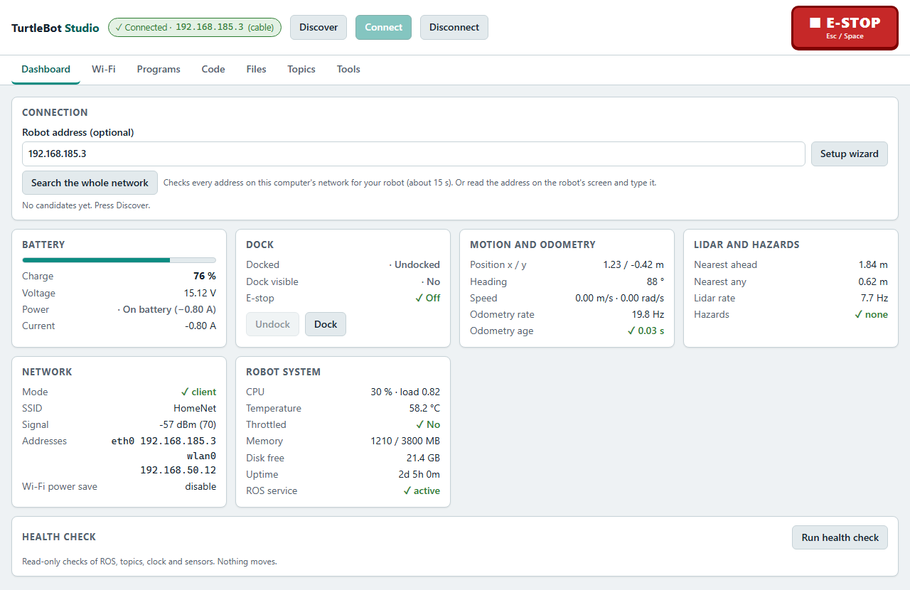
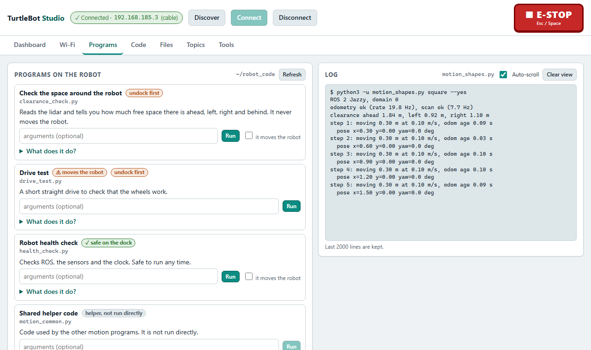
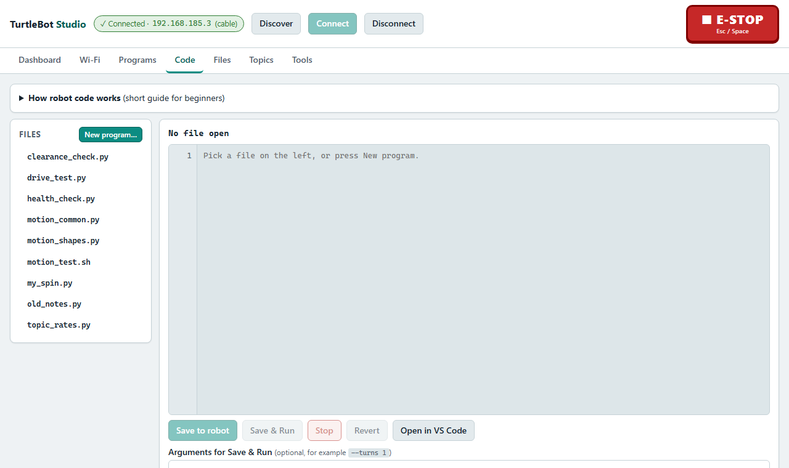
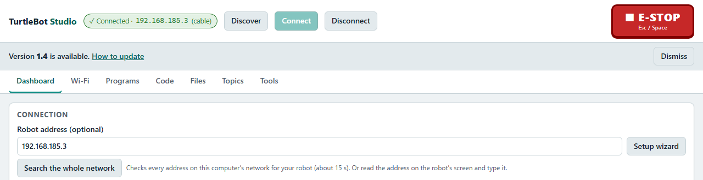
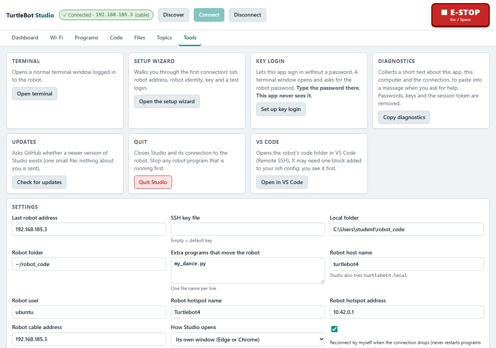

# Everyday use

How to use Studio once the [first connection](FIRST-CONNECTION.md) is done.

Guides: [First connection](FIRST-CONNECTION.md) | [Everyday use](EVERYDAY-USE.md) | [Find the robot](FIND-THE-ROBOT.md) | [Troubleshooting](TROUBLESHOOTING.md)

> Status: version 1.3 was tested offline and against the simulated robot only. Open real-robot checks: README [Not verified yet](../README.md#not-verified-yet). Screenshots will be added later.

## Safety first

- **E-STOP** is always at the top of the page. Click it, or press **Esc** or **Space**. It stops the motion programs, sends zero velocity and switches the drive motors off. A red banner stays until you press **Release e-stop** and confirm.
- In the Code editor, Esc and Space do not trigger the e-stop, because you are typing. **Ctrl+Shift+E** works everywhere.
- Anything that moves the robot asks for a confirmation. Read it before you confirm.
- Stay next to the robot while it moves, with about 1 m of clear floor. Read the [safety checklist](../../../examples/README.md#safety-checklist-before-anything-moves).

## 1. Start Studio

| Install | How to start |
|---|---|
| Windows installer | Start menu or desktop shortcut **TurtleBot Studio**. It opens in its own window, with no console window |
| Single file (Windows, macOS, Linux) | Double-click it, or run it in a terminal. See [INSTALL.md](../INSTALL.md#2-start-it) |
| Python | `python studio.py` in the `studio` folder |

If Studio is already running, starting it again just brings up the open window.

The address of the page contains a private token. Do not share it.

## 2. Connect

1. Make sure your computer is on the same network as the robot, or plugged into it with the cable.
2. Press **Discover**, pick the robot and press **Connect**.
3. If the robot is not listed, see [Find the robot](FIND-THE-ROBOT.md).

You do not need a password. If Studio says "key not set up", you have not done the [first connection](FIRST-CONNECTION.md) on this computer.

If the connection drops, Studio tries to reconnect by itself. See [When the connection drops](#when-the-connection-drops).

*Screenshot from the simulated robot.*

## 3. The tabs

| Tab | Use it to |
|---|---|
| Dashboard | See battery, docked or not, lidar, Wi-Fi, CPU and temperature. Undock and Dock. **Start lidar motor** if programs report "no /scan". Run the health check |
| Programs | Run one of the lab's example programs and see its live log. Each card explains what the program does and whether it moves the robot |
| Files | Copy a folder from your computer to the robot and back. **Sync and run** copies and starts a program in one step |
| Topics | List the ROS topics and watch up to four live |
| Wi-Fi | See where your computer and the robot are connected. Put the robot on another network ([First connection, step 3](FIRST-CONNECTION.md#3-put-the-robot-on-the-network-you-will-use)) |
| Code | Write and run your own program on the robot |
| Tools | Open a terminal on the robot, open the robot in VS Code, settings, the app log, copy diagnostics, check for updates, quit Studio |

## 4. Run a program

1. Open the **Programs** tab.
2. Read the card. A badge tells you if it moves the robot, whether it is safe on the dock, and whether it needs an undock.
3. Press **What does it do?** to see its arguments and how it stops.
4. If the robot has to undock first, go to the Dashboard and press **Undock**, then confirm.
5. Set the arguments, tick the motion confirmation if the program moves the robot, and press **Run**.
6. Watch the live log. Press **Stop** to end the program.

If you do not tick the motion confirmation for a motion program, Studio refuses to start it.

*Screenshot from the simulated robot.*

## 5. Edit and run your own code

1. Open the **Code** tab. Press **New program** and choose a template, or open a file from `~/robot_code`.
2. Edit it. Tab indents and Ctrl+S saves.
3. Press **Save to robot**. If Studio says "No changes to save", nothing was different from the file on the robot and no backup was made. Otherwise the save keeps one `.bak` copy of the old file and warns you if the file changed on the robot since you opened it.
4. Press **Save and Run** to save and start it. A program that moves the robot needs the motion confirmation. **Stop** ends it.
5. **Revert** reloads the robot's version. **Open in VS Code** opens the robot in VS Code (it asks before it changes your ssh config).

*Screenshot from the simulated robot.*

## 6. Move files

1. Open the **Files** tab and choose a folder on your computer and a folder on the robot.
2. Studio compares the two (by content) and lists what is different.
3. Use the dry run first, then upload or download.
4. Studio deletes nothing unless you ask for it and confirm.

File access on the robot is limited to the robot's home folder.

## When the connection drops

If the connection ends without you pressing Disconnect (for example the Wi-Fi blinks), Studio shows a banner: "Connection lost at HH:MM. Reconnecting (attempt n, next in s)".

- It retries with growing pauses and gives up after 10 minutes.
- Press **Stop reconnecting** to stop it.
- When it works again you see a short "Reconnected" message.
- Reconnecting never restarts a program, never sends a movement command and never releases an e-stop. A program you started keeps running on the robot even while Studio is disconnected. Stop it from the Programs tab, or use E-STOP.
- Pressing **Disconnect** yourself never triggers a reconnect.
- You can turn this off with the `auto_reconnect` setting in the settings.

## Updates

Studio checks once a day whether a newer version exists and shows a banner "Version X is available. How to update". The check sends no identifiers. Dismiss the banner and it stays away for that version. **Tools, Check for updates** checks now. Switch the check off with the `update_check` setting.

*Screenshot from the simulated robot.*

## Quit

- Press **Tools, Quit Studio** and confirm. The page then says "Studio has stopped. You can close this window."
- The installed app also stops by itself after you close its window and no page is open for about 45 seconds. When run from source, Studio stays open until you quit it.
- If you want to log out of the robot as well, press **Disconnect** first.

*Screenshot from the simulated robot.*

## Something wrong

See [Troubleshooting](TROUBLESHOOTING.md). To ask for help, press **Copy diagnostics** (Tools tab) and send the text to the lab maintainer.
