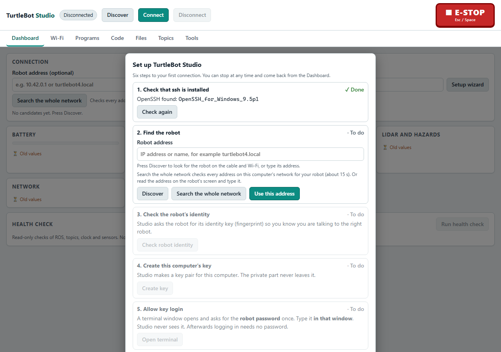
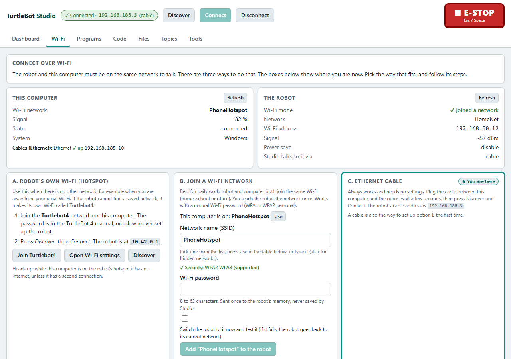

# First connection to the robot (do this once)

Read this before you use Studio for the first time. It takes about 10 minutes. After it, you do not need the cable again. The robot password is needed for only two things: allowing key login from this computer (once) and adding a Wi-Fi network to the robot.

Guides: [First connection](FIRST-CONNECTION.md) | [Everyday use](EVERYDAY-USE.md) | [Find the robot](FIND-THE-ROBOT.md) | [Troubleshooting](TROUBLESHOOTING.md)

> Status: version 1.3 was tested offline and against the simulated robot only. Not every step below has been run on the real robot yet. The open checks are listed in the README under [Not verified yet](../README.md#not-verified-yet).

## The short version

1. Plug an Ethernet cable between your computer and the robot.
2. Start Studio and follow the setup wizard. Type the robot password in the terminal window the wizard opens (once per computer).
3. While the cable is still plugged in, open the **Wi-Fi** tab, press **Join a Wi-Fi network** and put the robot on the network you will use.
4. Unplug the cable. From now on: **Discover**, then **Connect**.

## Why the cable

The first connection is a one-time step. The cable is the most reliable way to do it, because it needs no Wi-Fi at all. It works when the lab Wi-Fi is out of range, when you do not know the robot's address, and when the robot is on a network your computer cannot see.

On the cable the robot is always at `192.168.185.3`. Your computer normally gets no matching address on the cable, so Studio finds the robot by its IPv6 link-local address (it starts with `fe80::`). You do not have to change any network setting on your computer. More about the cable: [Connect with an Ethernet cable](../../../HOW-TO-CONNECT.md#connect-with-an-ethernet-cable-no-wi-fi-needed).

You need:

- Studio installed ([INSTALL.md](../INSTALL.md)).
- An Ethernet cable and, if your computer has no wired port, a USB or Thunderbolt Ethernet adapter.
- The robot switched on. Plug the cable into the Ethernet port of the Raspberry Pi on the robot.
- The robot's `ubuntu` password. Ask the lab maintainer. Do not write it in documents, chats or screenshots.
- For step 3: the name and password of the Wi-Fi network you want. It must be WPA or WPA2 personal (one shared password). Networks that need a login page or a university account (for example `eduroam`) are not supported.

## Steps

### 1. Connect the cable

1. Plug one end into your computer and the other into the robot.
2. Wait about 20 seconds for the link to come up.

### 2. Start Studio and run the setup wizard

1. Start Studio ([INSTALL.md](../INSTALL.md#2-start-it)). The wizard opens by itself the first time. If it does not, press **Setup wizard** on the Dashboard or in the Tools tab.
2. Go through the six steps:

| Step | What you do |
|---|---|
| 1 ssh present | Nothing, if the check is green. If not, follow the hint on the screen |
| 2 Robot address | Press **Discover**. The robot appears as **Cable (IPv6)** with an address starting `fe80::` (or as `192.168.185.3` if your computer has a fixed cable address). Pick it. If Discover finds nothing, wait 20 seconds and press **Discover** again, then see [Find the robot](FIND-THE-ROBOT.md) |
| 3 Robot identity | The lab robot shows "known robot". For any other TurtleBot 4, compare the fingerprint as the wizard describes, or ask the lab maintainer |
| 4 Key | Studio creates a login key for this computer |
| 5 Key login | Press **Open terminal**. See the next part |
| 6 Test | Studio logs in with your key and shows the robot's name. Press **Connect** |

*Screenshot from the simulated robot.*

### Typing the robot password (step 5)

- A terminal window opens on your computer. It asks for the robot's `ubuntu` password.
- Type the password in that window. Nothing is shown while you type. That is normal. Press Enter.
- Type it there and nowhere else. Never type it in the Studio page. Studio never sees it.
- When the terminal says it is done, close it and go back to Studio.

You do this once for each computer. The password is not saved anywhere.

### 3. Put the robot on the network you will use

Do this while the cable is still plugged in. The cable stays up while the robot changes network, so you cannot lock yourself out.

1. In Studio, open the **Wi-Fi** tab.
2. Under **Join a Wi-Fi network**, pick the network from **Networks the robot can see**, or type its name. If the robot is running its own hotspot it cannot scan, so type the name.
3. Type the Wi-Fi password in Studio. Tick **Switch the robot to it now and test it**.
4. Press the button and confirm. A terminal opens again and asks for the robot's `ubuntu` (sudo) password. Type it there.
5. Wait up to 45 seconds. Studio shows the result and the robot's new address. Write that address down. It is also shown on the robot's screen.
6. If it fails (wrong password, network out of range), the robot goes back to the network it was on. This can take about 1.5 minutes. Check the name and password and try again.

The Wi-Fi password goes to the robot once, over the existing ssh link. Studio does not write it to disk or to its log.

*Screenshot from the simulated robot.*

### 4. Unplug the cable

1. Join your computer to the same Wi-Fi network as the robot.
2. Unplug the cable.
3. In Studio press **Discover**, pick the robot and press **Connect**.

If the robot is not found, see [Find the robot](FIND-THE-ROBOT.md).

## What was saved, and where

| Where | What | Why |
|---|---|---|
| On the robot | The public half of this computer's login key, in `~/.ssh/authorized_keys` | Lets this computer log in without the password. It is valid on every network until someone removes it |
| On this computer | Your private login key (it never leaves the computer) | Proves it is you |
| On this computer | The robot's identity (its host key) and the addresses Studio used | Studio only talks to a robot it recognises, and tries the last address first |
| On this computer | Studio's settings | See the settings folder in [INSTALL.md](../INSTALL.md#reset-or-remove-studio) |

Not saved by Studio: the robot password and the Wi-Fi password. (The robot keeps its own profile for the Wi-Fi network you joined. That is on the robot.)

Another computer needs its own first connection. To start over on this computer, delete the settings folder. To remove your key from the robot, ask the lab maintainer.

## After this

| Situation | What to do |
|---|---|
| Normal day | Start Studio, **Discover**, **Connect**. No cable, no password |
| The robot's address changed | Read the address on the robot's screen and type it, or press **Search the whole network**. See [Find the robot](FIND-THE-ROBOT.md) |
| No known Wi-Fi in range | The robot starts its own hotspot `Turtlebot4` (robot at `10.42.0.1`). Join it from your computer |
| Something fails | [Troubleshooting](TROUBLESHOOTING.md) |

Next: [Everyday use](EVERYDAY-USE.md).
