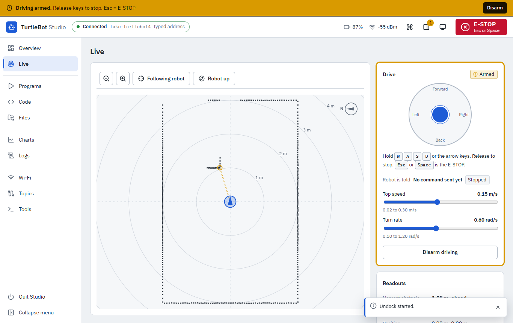
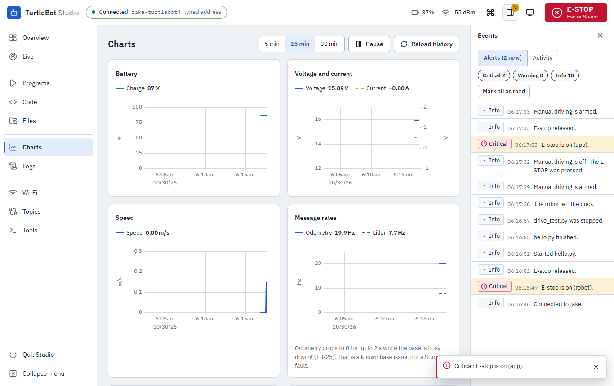
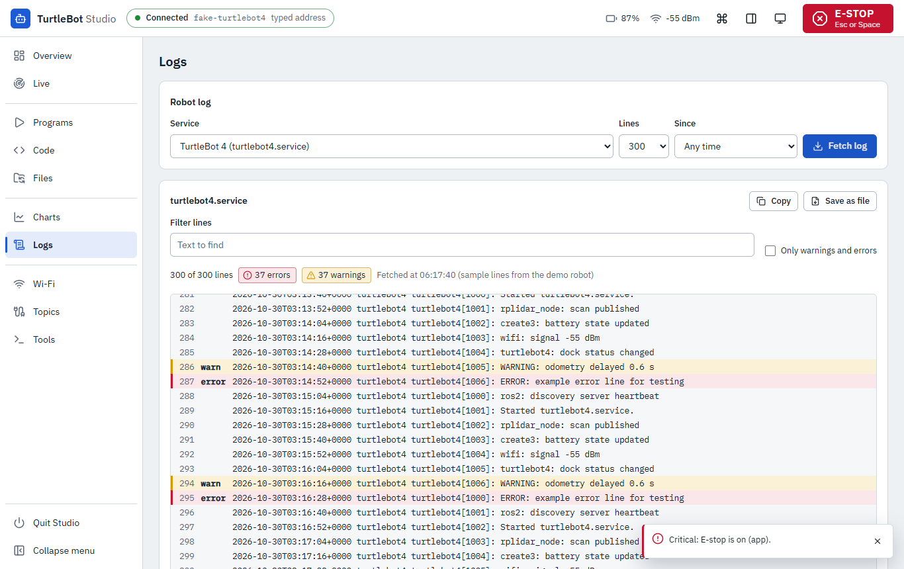

# Live view, driving, charts, events and logs

How to use the screens added in Studio 2.0: **Live** (map and driving), **Charts**, the **Events** drawer and **Logs**.

Guides: [First connection](FIRST-CONNECTION.md) | [Everyday use](EVERYDAY-USE.md) | [Live view and driving](LIVE-AND-DRIVING.md) | [Find the robot](FIND-THE-ROBOT.md) | [Troubleshooting](TROUBLESHOOTING.md)

> Status (2026-10-30): version 2.0 was tested offline, in the simulated robot and with automated browser tests. **Driving was tested only with the simulated robot so far.** It has not run on the real robot. The robot checks are listed in the README under [Not verified yet](../README.md#not-verified-yet). Until they pass, treat driving as new: stay next to the robot and keep a hand near **Esc** or **Space**.

## Safety first

1. Stand next to the robot. Keep about 1 m of clear floor around it.
2. The **E-STOP** button is at the top right of every screen. **Esc** or **Space** does the same, anywhere in Studio (not while you type in a text box). **Ctrl+Shift+E** works everywhere.
3. Driving is off until you arm it, and it switches itself off in the cases listed under [When driving switches off](#when-driving-switches-off).
4. Read the [safety checklist](../../../examples/README.md#safety-checklist-before-anything-moves) before the robot moves.

## The Live view

Open **Live** in the left menu. The map shows what the robot sees, from above.

*Screenshot from the simulated robot.*

| What you see | What it means |
|---|---|
| Dark dots | Lidar points: where the lidar sees a wall or an object |
| Blue disc with a wedge | The robot. The wedge points the way it faces |
| Line of dots behind the robot | The trail: where the robot has been (odometry). **Clear trail** wipes it |
| Grey rings with labels (for example 1 m, 2 m) | Distance from the robot. The spacing widens when you zoom out |
| Orange dashed line | The line to the nearest obstacle. The **Nearest obstacle** readout gives the distance and direction |
| Compass at the top right | Which way north is on the map |

Map controls:

| Control | What it does |
|---|---|
| Zoom buttons, mouse wheel, pinch | Zoom in and out |
| Drag | Move the map. This switches from **Following robot** to **Free view** |
| **Following robot** / **Free view** | Keep the robot in the centre, or leave the map where you put it |
| **Robot up** / **North up** | Turn the map with the robot (the robot always points up), or keep the map fixed with the compass |

Notes:

- "North" is a fixed direction on the map (the robot's odometry frame), not the real compass.
- The map and the trail show odometry. They drift over time and are not a saved map of the room.
- While the robot is docked, the lidar motor is normally off. The map then says "No lidar data" and that the lidar is off while docked. This is normal. Undock the robot, or press **Start lidar motor** on **Overview**, to see points.
- If points stop arriving for more than 1 second the dots dim and the message appears. Check the lidar on **Overview**.
- Studio asks the robot for the scan and the pose only while Live is open, visible and connected. It turns them off when you leave Live.
- The numbers in the readouts (nearest obstacle, position) come from the robot. Whether the real room matches the rings is [to verify] on the real robot.

## Drive the robot

### Before you arm

1. Stand next to the robot, with about 1 m of clear floor around it.
2. Undock the robot (**Overview**, **Undock**, confirm). The robot cannot be armed while docked.
3. Open **Live**.

### Arm

1. In the **Drive** panel press **Arm driving**.
2. Read the message and tick **I am next to the robot and about 1 m around it is clear**.
3. Confirm. The **Drive** panel turns amber and says **Armed**. An amber bar appears across the top of Studio: "Driving armed. Release keys to stop. Esc = E-STOP". It stays while driving is armed, on every screen you can still see.

### Drive

| Control | Action |
|---|---|
| **W** or arrow up | Forward |
| **S** or arrow down | Back |
| **A** or arrow left | Turn left |
| **D** or arrow right | Turn right |
| The joystick (hold and drag) | Forward, back, left, right, by how far you drag |

1. Hold a key or the joystick. The robot moves. Studio sends the command about 10 times a second.
2. Let go. The robot stops. Studio sends a stop command, and the robot stops by itself too (see [Three layers of stopping](#three-layers-of-stopping)).
3. The **Drive** panel shows what the robot was told ("Robot is told ...") and whether it is moving or **Stopped**.
4. Keys do not drive while you type in a box, while a slider has focus, or while a dialog is open.
5. When you finish press **Disarm driving**.

### Speed limits

| | Default | Highest you can set |
|---|---|---|
| Top forward speed | 0.15 m/s | 0.30 m/s |
| Turn rate | 0.60 rad/s | 1.20 rad/s |

- Move the **Top speed** and **Turn rate** sliders in the **Drive** panel, or set the numbers in **Tools, Settings, Driving limits**. The lowest values are 0.02 m/s and 0.10 rad/s.
- Studio and the robot both enforce the highest values. Typing a larger number only gives you the highest value.
- The lab's own rule for programs is 0.15 m/s. The sliders go higher. Stay at the default unless you have a reason and the lab maintainer agrees.

### When arming is refused

Studio shows the reason in plain words.

| Message | What to do |
|---|---|
| The robot is docked. Undock first. | Undock it from **Overview** |
| The e-stop is on. Release it first. | Press **Release e-stop** (top banner) only when it is safe |
| A motion program is running. Stop it first. | Stop it in **Programs**, or press **Stop all** |
| Battery below 10 %. Charge the robot before driving. | Dock and charge the robot |
| The robot state is not known yet. Wait a few seconds and try again. | Wait, then press **Arm driving** again |
| ROS is not ready ... | Wait a few seconds. If it stays, see [Troubleshooting](TROUBLESHOOTING.md) |

If the robot does not report a battery level, Studio does not refuse for the battery.

### When driving switches off

Driving disarms by itself, and the robot is told to stop, in each of these cases:

| Case |
|---|
| 60 seconds without a non-zero drive command (holding nothing, or only zero commands) |
| You leave **Live** (open another screen) |
| The Studio window is hidden or loses focus |
| The connection to the robot is lost, or Studio loses its event stream |
| The last Studio page is closed |
| You press E-STOP |
| The battery falls below 8 % ("Battery below 8 %. Manual driving was stopped.") |
| The robot docks, or a motion program or STOP file appears |
| Three drive commands in a row fail |
| You quit Studio |

Studio shows the reason in a message and in the **Events** drawer.

After any of these you must arm again, with the confirmation. Reconnecting never re-arms by itself.

### Three layers of stopping

1. You let go of the key or joystick. Studio sends a zero command.
2. If no new command reaches the robot for 0.3 s, the helper on the robot publishes zero velocity by itself. This holds even if Studio crashes or the network fails, because the timer runs on the robot.
3. E-STOP (button, Esc, Space, Ctrl+Shift+E) disarms, sends zero and switches off the drive motors.

Layer 2 is the reason a lost network does not leave the robot driving. The test with the real robot's base is still open ([Not verified yet](../README.md#not-verified-yet)). **Whether the Create 3 really stops 0.3 s after the last command has been checked only in the simulated robot.** Do not rely on it more than on the E-STOP.

### Phones and narrow windows

On a phone-width screen the **Drive** panel is hidden. Live shows a note that driving needs a wider screen. The map, the readouts and the **E-STOP** button still work.

## Charts

Open **Charts**. Studio keeps the last 30 minutes of values (one sample per second) in memory. The charts fill as the robot reports. They are empty right after you connect, and they are lost when Studio quits.

| Chart | Shows |
|---|---|
| Battery | Charge in % |
| Voltage and current | Battery voltage (V) and current (A, negative while charging) |
| Speed | Speed of the robot in m/s |
| Message rates | Odometry and lidar messages per second (Hz) |
| CPU and temperature | Robot CPU load and temperature |
| Wi-Fi | Signal strength in dBm (nearer 0 is stronger) |

- The buttons **5 min**, **15 min** and **30 min** change the window.
- **Pause** freezes the charts so you can look. **Reload history** loads the last values again.
- Hover or touch a chart for the exact value and time.
- Odometry drops to 0 for up to 2 seconds while the base is busy driving. That is the known base issue TB-25, not a Studio fault.

*Screenshot from the simulated robot.*

## Events

Press the **Events** button in the top bar (the panel icon). A number on it counts new warnings and critical alerts you have not seen.

- The **Alerts** tab lists what Studio noticed, with a severity (**Critical**, **Warning** or **Info**), the time and a short text. Examples: the battery is low, the e-stop was pressed or released, the robot docked or undocked, the lidar went silent while undocked, the Wi-Fi is weak, the robot is hot, the connection was lost or came back, a program started or ended, driving was armed or disarmed.
- The **Activity** tab lists the earlier messages of Studio and the robot.
- **Mark all as read** clears the number.
- Critical alerts also appear as a message at the bottom of the screen.
- The same alert is not repeated within 60 seconds. A state change (for example e-stop on, then off) is always shown.
- Studio saves alerts in a file in its settings folder (`events.jsonl`), so they are still there after a restart. The file stays small: at about 1 MB it is replaced by a new one and one older copy is kept.

## Logs

Open **Logs**. This is a read-only view of the robot's service log (the system journal on the robot).

1. Pick a **Service** (the default is **TurtleBot 4 (turtlebot4.service)**).
2. Pick how many **Lines** (50 to 2000) and **Since** (for example 10 minutes ago, 1 hour ago, since boot).
3. Press **Fetch log**.
4. Type in **Filter lines** to show only lines that contain your text. Tick **Only warnings and errors** to hide the rest.
5. **Copy** or **Save as file** keeps the lines for a bug report.

Warnings and errors are marked with the words **warn** and **error**, not only a colour.

*Screenshot from the simulated robot. The lines are sample text.*

If the log says it cannot be read (for example "permission"), the robot account is not allowed to read that log. Ask the lab maintainer. Do not try to fix it from Studio: Studio never uses sudo and never changes anything on the robot from this screen. Reading the real robot's log, the unit names and the permissions are not yet checked on the real robot.

## Shortcuts and the command list

| Key | Action |
|---|---|
| **Esc** or **Space** | E-STOP (not while typing) |
| **Ctrl+Shift+E** | E-STOP, also inside the code editor |
| **Ctrl+K** (**Cmd+K** on macOS) | Command list: go to any screen, Discover, Connect, Disconnect, health check, copy diagnostics, switch light or dark, open settings. It has no movement commands |
| **?** | Show the list of shortcuts |
| **W A S D** or arrows | Drive, only while driving is armed on **Live** |

Next: [Troubleshooting](TROUBLESHOOTING.md).
